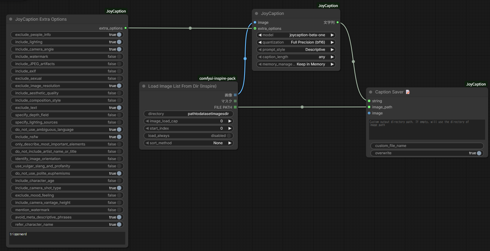

# Captioning Training Images for Krea2 LoRA

Krea2 is trained on natural-language prompts, so LoRA training captions should be
full sentences, not booru-style tags. This guide uses JoyCaption in ComfyUI to
caption a whole folder of images in one run.

## Requirements

- ComfyUI installed as a package in Stability Matrix
  (see [Stability Matrix setup](../stability-matrix/setup.md))
- ComfyUI Manager enabled (below)

The bundled workflow loads JoyCaption in full precision (bf16) and was tested on an
RTX 4090 (24 GB VRAM). See `quantization` in [Workflow Settings](#workflow-settings)
for GPUs with less VRAM.

## Enable ComfyUI Manager

ComfyUI Manager installs custom nodes from inside ComfyUI. Turn it on in the
ComfyUI launch options in Stability Matrix:

1. Open **Packages** in Stability Matrix.
2. Open the menu of the ComfyUI package and select **Launch Options**.
3. Under **Enable Manager**, check `--enable-manager`.
4. Select **Save**, then start ComfyUI.

Leave the other launch options at their defaults.

## Install the Custom Nodes

The workflow uses nodes from two custom node packs:

| Node | Pack |
|---|---|
| `JC` (JoyCaption) | [ComfyUI-JoyCaption](https://github.com/1038lab/ComfyUI-JoyCaption) |
| `JC_ExtraOptions` (JoyCaption Extra Options) | [ComfyUI-JoyCaption](https://github.com/1038lab/ComfyUI-JoyCaption) |
| `CaptionSaver` (Caption Saver) | [ComfyUI-JoyCaption](https://github.com/1038lab/ComfyUI-JoyCaption) |
| `LoadImageListFromDir //Inspire` (Load Image List From Dir) | [ComfyUI-Inspire-Pack](https://github.com/ltdrdata/ComfyUI-Inspire-Pack) |

Install them with ComfyUI Manager:

1. In ComfyUI, open **Manager**, then **Custom Nodes Manager**.
2. Search for `ComfyUI-JoyCaption` and install the pack by 1038lab.
3. Search for `ComfyUI-Inspire-Pack` and install it.
4. Restart ComfyUI.

The JoyCaption model itself is downloaded from Hugging Face the first time the
workflow runs.

## Load the Workflow

Download [`workflows/joycaption-batch-captioning.json`](./workflows/joycaption-batch-captioning.json)
and drag it onto the ComfyUI canvas.

The workflow reads every image in the folder, captions it with JoyCaption, and saves
the caption next to the image:

1. **Load Image List From Dir** loads the images and passes their file paths along.
2. **JoyCaption Extra Options** sets what the captions should and should not include.
3. **JoyCaption** writes a caption for each image.
4. **Caption Saver** saves each caption as a text file.

Before running it, change these two values:

| Node | Field | Placeholder | Set to |
|---|---|---|---|
| Load Image List From Dir | `directory` | `pathtodatasetimagesdir` | The folder with your training images |
| JoyCaption Extra Options | `character_name` | `triggerword` | Your LoRA trigger word |

Each image gets a `.txt` file with the same name, which is the format ai-toolkit expects.

## Workflow Settings

The values below are the ones in the bundled workflow. They are tuned for
character LoRAs on an RTX 4090 (24 GB VRAM).

### Load Image List From Dir

| Setting | Value | Description |
|---|---|---|
| `directory` | `pathtodatasetimagesdir` | Folder to read images from. Placeholder, change it. |
| `image_load_cap` | `0` | Maximum number of images to load. `0` loads all images. Set a small number to test the settings on a few images first. |
| `start_index` | `0` | Index of the first image to load. Use it to resume a run that stopped part way. Set `sort_method` to `Alphabetical (ASC)` first, so the order is the same on every run. |
| `load_always` | `false` | When `false`, ComfyUI reuses the images from the previous run while the node settings stay the same. Turn it on if you add or replace images in the same folder; the folder is then read again on every run. |
| `sort_method` | `None` | Order in which images are loaded, such as `Alphabetical (ASC)` or `Datetime (ASC)`. The order does not affect the captions. |

### JoyCaption

| Setting | Value | Description |
|---|---|---|
| `model` | `joycaption-beta-one` | JoyCaption Beta One, downloaded from Hugging Face on first run. |
| `quantization` | `Full Precision (bf16)` | Best quality, highest VRAM use. Use `Balanced (8-bit)` on GPUs with less VRAM, or `Maximum Savings (4-bit)` if 8-bit still runs out of memory. |
| `prompt_style` | `Descriptive` | Writes a detailed natural-language description, which suits Krea2. Tag styles such as `Danbooru tag list` are for tag-based models; do not use them for Krea2. |
| `caption_length` | `any` | Lets the model decide the length. Set `short` or `medium` if captions become too long or start describing unimportant details. |
| `memory_management` | `Keep in Memory` | Keeps the model loaded between images, which is fastest for batch runs. Use `Clear After Run` if you need the VRAM for something else right after captioning. |

### JoyCaption Extra Options

Each option adds one instruction to the prompt sent to JoyCaption.
`ON` options in this workflow are in **bold**.

| Setting | Value | Description |
|---|---|---|
| **`exclude_people_info`** | `true` | Does not describe traits that cannot change, such as ethnicity or gender, but still describes changeable ones such as hairstyle. For character LoRAs this lets the fixed traits bind to the trigger word. Turn it off for style or concept LoRAs. |
| **`include_lighting`** | `true` | Describes the lighting. |
| **`include_camera_angle`** | `true` | Describes the camera angle. |
| `include_watermark` | `false` | States whether there is a watermark. |
| `include_JPEG_artifacts` | `false` | States whether there are JPEG artifacts. Turn it on if some images are low quality and you want the LoRA to separate the artifacts from the subject. |
| `include_exif` | `false` | For photos, guesses camera, aperture, shutter speed and ISO. Only useful for photo LoRAs. |
| `exclude_sexual` | `false` | Keeps the caption PG. Turn it on for an SFW-only dataset. |
| **`exclude_image_resolution`** | `true` | Does not mention the image resolution. |
| `include_aesthetic_quality` | `false` | Rates the aesthetic quality from low to very high. |
| `include_composition_style` | `false` | Describes composition, such as leading lines or rule of thirds. |
| **`exclude_text`** | `true` | Does not mention text in the image. Turn it off if the text is part of what the LoRA should learn. |
| `specify_depth_field` | `false` | Describes depth of field and background blur. |
| `specify_lighting_sources` | `false` | Says whether the light is natural or artificial. |
| **`do_not_use_ambiguous_language`** | `true` | Avoids vague wording. |
| **`include_nsfw`** | `true` | Rates the image as SFW, suggestive or NSFW. It adds a rating; it does not make captions explicit by itself. Turn it off for an SFW-only dataset. |
| `only_describe_most_important_elements` | `false` | Describes only the main elements. Turn it on if captions are too long. |
| `do_not_include_artist_name_or_title` | `false` | Leaves out the artist name and title of artworks. |
| `identify_image_orientation` | `false` | States portrait, landscape or square, and the aspect ratio. |
| `use_vulgar_slang_and_profanity` | `false` | Uses vulgar slang. Keep it off. |
| **`do_not_use_polite_euphemisms`** | `true` | Uses blunt, direct wording instead of euphemisms, so the caption names what is in the image. Turn it off for an SFW-only dataset if you prefer softer wording. |
| `include_character_age` | `false` | Describes the age of people or characters. |
| **`include_camera_shot_type`** | `true` | Names the shot type, such as close-up, cowboy shot or wide shot. Helps control framing at generation time. |
| `exclude_mood_feeling` | `false` | Leaves out mood and feeling. |
| `include_camera_vantage_height` | `false` | Names the vantage height, such as eye level or bird's-eye. |
| `mention_watermark` | `false` | Mentions a watermark if there is one. |
| **`avoid_meta_descriptive_phrases`** | `true` | Avoids phrases like "This image shows...". These phrases waste tokens and do not appear in real prompts. |
| **`refer_character_name`** | `true` | Refers to the person or character by `character_name`, so the trigger word appears in every caption. Turn it off for style LoRAs that have no character. |
| `character_name` | `triggerword` | The trigger word used by `refer_character_name`. Placeholder, change it. |

### Caption Saver

| Setting | Value | Description |
|---|---|---|
| `custom_output_path` | *(empty)* | Empty saves each `.txt` next to its image. Set a folder to save captions elsewhere. |
| `custom_file_name` | *(empty)* | Empty uses the image file name. Leave it empty for training datasets. |
| `overwrite` | `true` | Overwrites existing caption files. Set `false` to keep old captions; new files then get a number added to the name. |

## Edit the Captions

JoyCaption describes everything it sees. Before training, edit the captions so the
trigger word learns only what you want it to learn.

The basic idea: **anything not written in the caption is learned by the trigger word.
Anything written in the caption is not.**

### 1. Remove what the trigger word should learn

Delete the character's fixed features from every caption:

- Hairstyle and hair color
- Eye color
- Face and facial features, such as moles or blushing cheeks

`exclude_people_info` in the workflow already leaves out traits such as gender and
ethnicity, but it keeps changeable traits such as hairstyle. Remove those by hand.

### 2. Keep what the trigger word should not learn

Leave these in the caption, so they can be changed or left out at generation time:

- Accessories, such as hairpins, ribbons, flowers and hats
- Makeup, such as lipstick, eyeshadow and nail polish
- Anything that differs from the character's default look, such as a different
  hairstyle, lighting that changes how the hair color looks, or different glasses
  frames. Writing these down keeps the default look in the trigger word.

### 3. Decide character-specific features one by one

Some features could belong to either group. Decide for each character:

| Feature example | Decision | Caption |
|---|---|---|
| Glasses that the character always wears | Part of the character | Do not write |
| Skin tone that is part of the character | Part of the character | Do not write |
| Animal ears and tail | Removable | Always write |
| A signature hair clip | Removable | Always write |

If you train separate LoRAs for one character with different hairstyles, keep one
hairstyle per dataset folder and do not write that hairstyle in its captions.

### 4. Use precise wording

- **Skin shine**: always describe it, and say how strong it is.
  - Strong: `shiny and glossy, with strong specular highlights`
  - Weak: `slightly shiny`
  - Avoid vague phrases such as `smooth skin` or `highlights her skin`.
- **Wet**: use `wet` or `water droplets` only when the image is actually wet. For an
  oily shine, write `oiled, shiny`, not `wet`.
- **CGI images**: replace `photograph` with `digital artwork`.
- **Art style words**: do not add the same style word, such as `3D CGI render`, to every
  caption. A word that appears in every caption soaks up the character's features,
  and the trigger word learns less.

### 5. Clean up the dataset

Remove near-duplicate images with almost the same scene and pose. They bias the LoRA
toward that scene.
